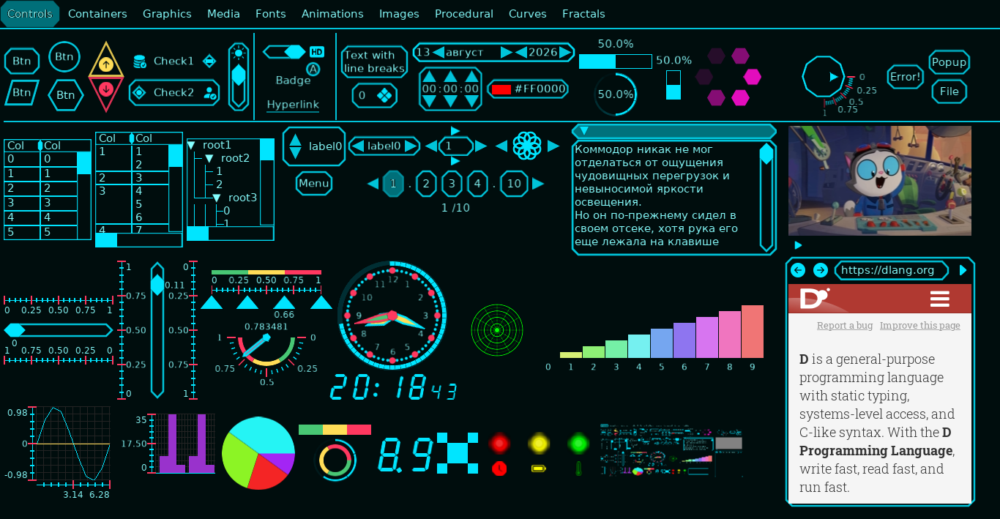
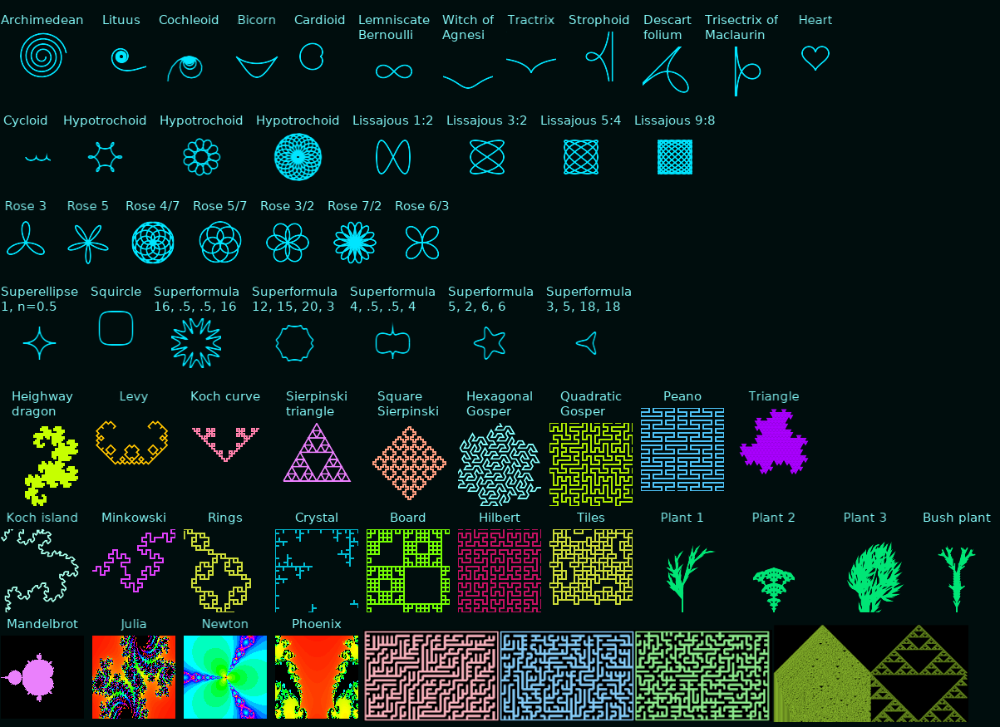
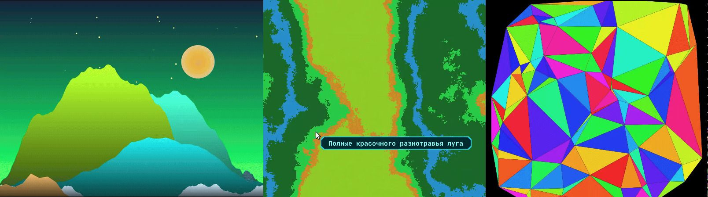
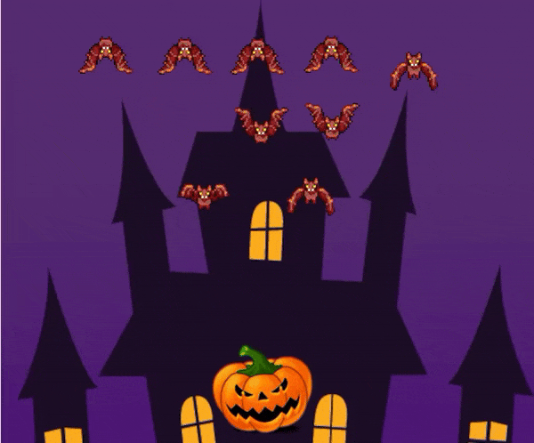
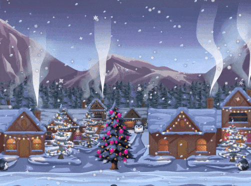
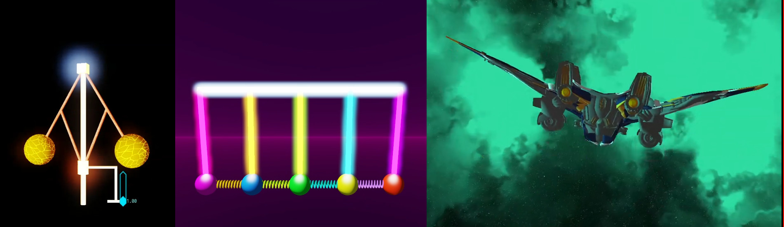

Deltotum is a work-in-progress graphics engine and GUI toolkit written in D.

> [!Warning]
> The API is highly unstable and subject to breaking changes. This repository is experimental only!

## GUI (SDL_Renderer, Cairo)

## 2D (SDL_Renderer, Cairo)

Halloween demo assets:
https://opengameart.org/content/dark-halloween-castle
https://opengameart.org/content/halloween-animation-pumpkin
https://opengameart.org/content/angel-wings-effect
https://opengameart.org/content/bat-rework
https://opengameart.org/content/rodents-rat-rework

New year demo assets:
https://opengameart.org/content/winter-holiday-2d-backgrounds
https://gamedeveloperstudio.itch.io/smoke-whisp
https://karsiori.itch.io/free-pixel-art-christmas-trees
https://jitsukoan.itch.io/little-pingu

## 3D (SDL GPU, in progress)

Some videos are available on YT: https://www.youtube.com/playlist?list=PL-kVIrOmkk0L3kfijf5JshQE5nNLJ0wt0

